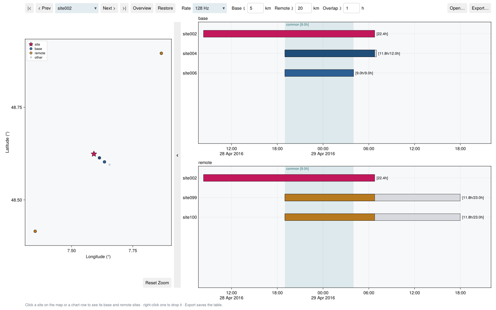
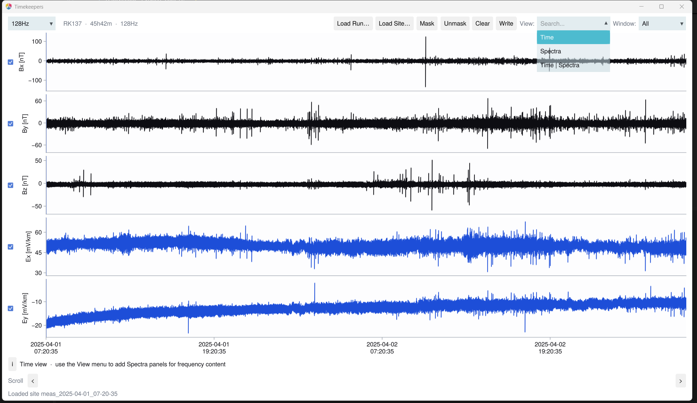

```@raw html
---
layout: home

hero:
  name: "Timekeepers.jl"
  tagline: Timeseries analysis in Electromagnetic Geophysics
  actions:
    - theme: brand
      text: Getting Started
      link: /getting_started
    - theme: alt
      text: GitHub
      link: https://github.com/JuliaGeophysics/Timekeepers.jl
---

<div class="tk-features">
  <a class="tk-feature" href="./tkdash">
    <h2>TKDash</h2>
    <p>Scan a survey. See which sites recorded together, and find the base and remote sites of each site.</p>
    
    <span class="tk-link">Open TKDash guide →</span>
  </a>
  <a class="tk-feature" href="./tkapp">
    <h2>TKApp</h2>
    <p>Open a recording. Scroll through it, mask bad intervals, check the spectra and write clean data.</p>
    
    <span class="tk-link">Open TKApp guide →</span>
  </a>
  <a class="tk-feature" href="./tkproc">
    <h2>TKProc</h2>
    <p>Process a site. Estimate its impedance and tipper with base and remote sites, and write EDI files.</p>
    
    <span class="tk-link">Open TKProc guide →</span>
  </a>
</div>
```

Read magnetotelluric and geomagnetic recordings (LEMI-424, GEOMAG-02, Metronix ADU), mask the bad
parts, write clean data and estimate transfer functions. Part of
[JuliaGeophysics](https://github.com/JuliaGeophysics).

## Quick start

```bash
git clone https://github.com/JuliaGeophysics/Timekeepers.jl
cd Timekeepers.jl
julia --project=. -t auto -e "using Pkg; Pkg.instantiate()"
```

```julia
using Timekeepers
run_tkapp("data/LEMI090.txt")      # open a recording
```

New to Julia? Follow [Getting Started](getting_started.md).

To cite Timekeepers.jl, cite the repository: <https://github.com/JuliaGeophysics/Timekeepers.jl>.
