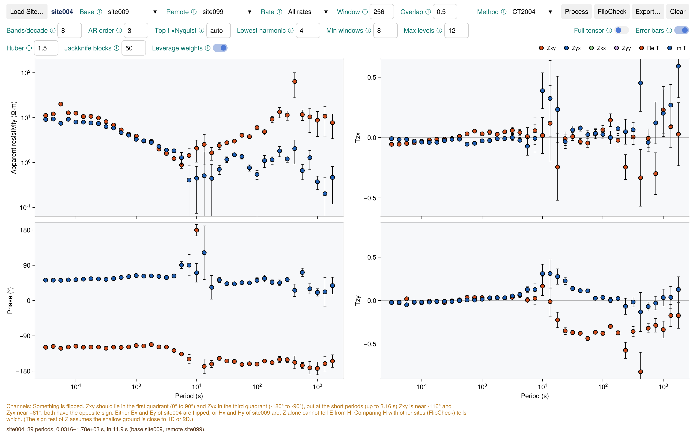

# TKProc

Estimate the impedance and tipper of a site, with its base and remote sites, and write an EDI file.

!!! warning "Experimental"
    Options and output may still change.



```julia
using Timekeepers
run_tkproc("data/survey")   # start Julia with `julia -t auto`
```

| To | Do |
|:---|:---|
| Open a survey | **Survey…** |
| Pick a site | **Site** |
| Set it up | **Base**, **Remote**, **Rate** and the options; **Save set-up** stores them in the site's `procset.dat` |
| Estimate | **Process** (also saves the set-up to `procset.dat`) |
| Save | **Export…** → `<name>.edi` and `<name>.png` |

- If you exported a plan from [TKDash](tkdash.md), TKProc uses it.
- The first **Base** entry is the site itself (its own Hx, Hy).
- **Min km** hides the remote sites nearer than that (0, the default, lists them all); `procset.dat`
  keeps it as `min_distance` in metres.
- `min_period`, `max_period`, `span` and `rotate` are set only in the site's
  `procset.dat`. TKProc reads them when you pick the site and at each **Process**.

## Survey layout

```
survey/
├── s/              coil calibration files, e.g. MFS07e160.txt
├── d/dipoles.dat   dipole distances of each site
├── site002/
└── site004/
```

`d/dipoles.dat`: one header line, then per site the distances in metres from the centre to the N,
S, E and W electrodes (Ex = N + S, Ey = E + W; `-` if unknown; no comments):

```
site       N      S      E      W
site002   24.5   48.5   50.9   51.5
site004   49.0   51.2   51.0   51.0
```

Dipole lengths come from `d/dipoles.dat`, then the `.ats` header, else 50 m per electrode. LEMI-424
and GEOMAG files have no electrode positions, so give their sites a line.

## Output names

`<name>` lists the settings that made the estimate, so you can repeat it:

```
site-base-remote-rate-window-overlap-bands-prewhiten-top-harmonic-windows-levels-method-huber-leverage-jackknife
site002-site002-site099-all-256-0.5-8-3-auto-4-8-12-ct2004-1.5-1-50.edi
```

The remote is `none` when there isn't one. The EDI's INFO block lists each dipole length and its
source, each calibration file and all the options.
